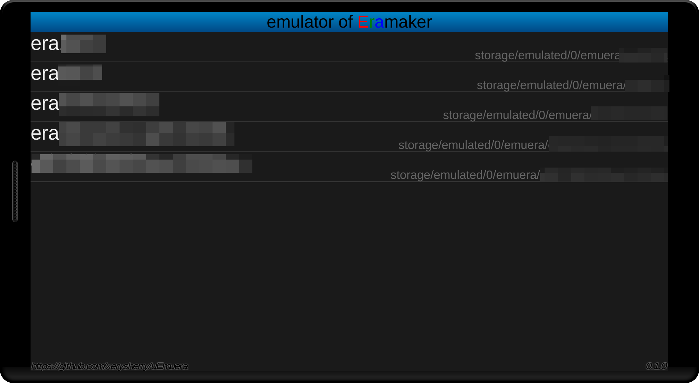
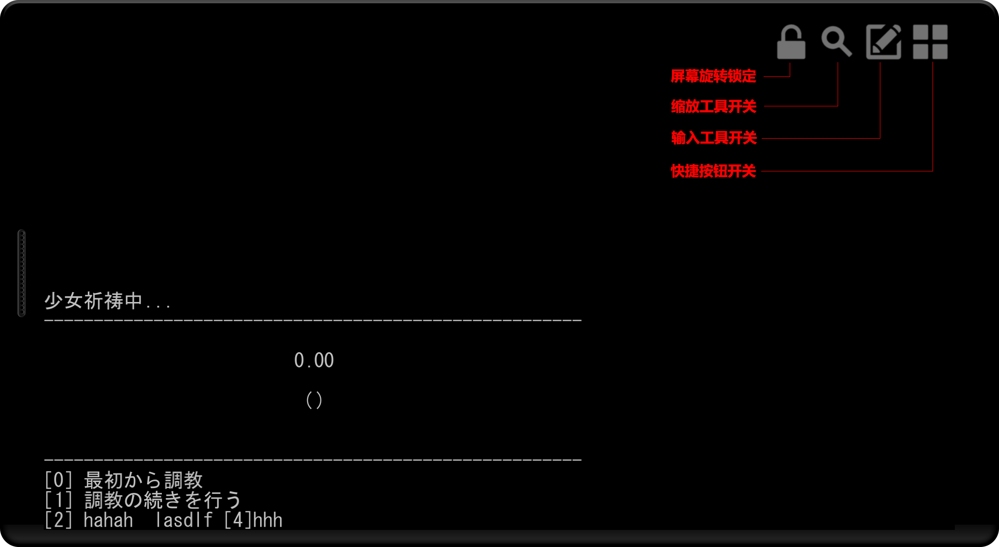
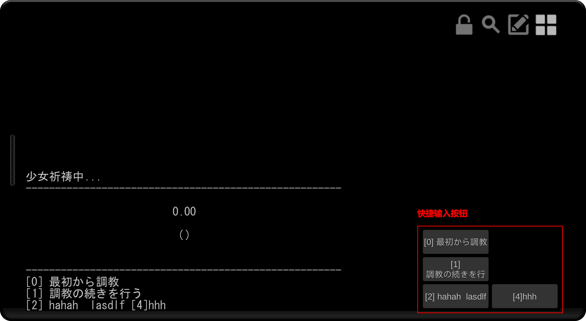
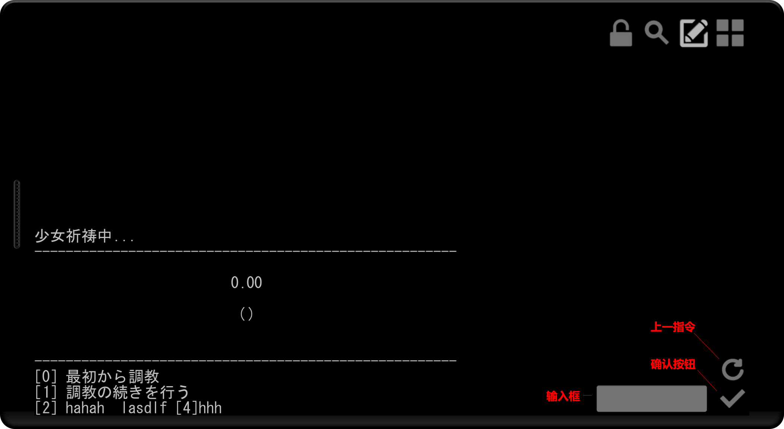
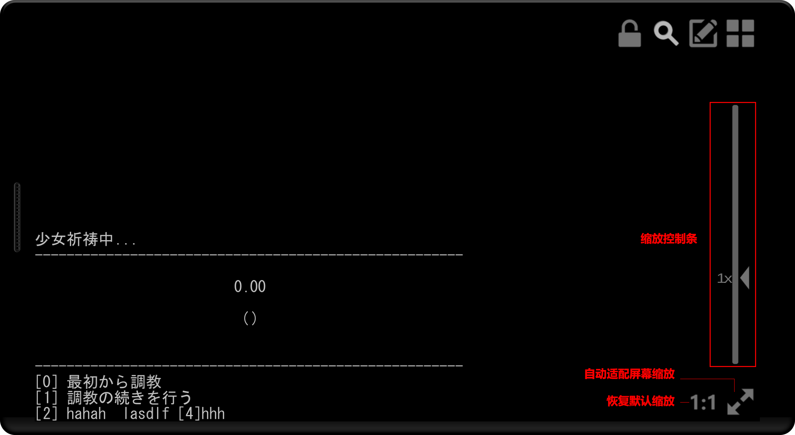

# uEmuera-Comet

## 关于本版本

本版本是 uEmuera-comet 的第三方魔改版（非官方），由个人开发者基于兴趣维护。

## 修改起因

原版在部分设备或游戏脚本下，存在图片渲染错误/显示异常问题。本版本针对该图文渲染逻辑进行了有限修复，旨在提升可用性。

## 改动清单（已实现）

1. **GXX 全指令软件光栅化**：`GCREATE` / `GCLEAR` / `GFILLRECTANGLE` / `GDRAWSPRITE` / `GDRAWG` / `GDRAWGWITHMASK` / `GSETCOLOR` / `GGETCOLOR` 由原版的空实现改为基于 CPU 端 `Color32` 缓冲实现，通过 `ApplyPixelBuffer()` 上传到 `Texture2D`。
2. **线程化纹理加载**：新增主线程调度（`IsMainThread` / `RunOnMainThread` / `ProcessMainThreadActions`），异步加载的同步原语由 `Mutex` 改为 `ManualResetEvent`。
3. **WebP 直接解码为像素**：新增 `DecodeWebPToPixels`，并提供可读纹理副本（`MakeReadable`）。
4. **BitmapPixelBuffer 直挂寻址**：`GCREATE` 产生的画布不再走文件名查找，直接以 `:GRAPHICS:{ID}` 注册进纹理字典。
5. **按钮位图像素缓存**：新增 `CacheButtonMapPixels` / `GetButtonMapPixel`，CBG 点击判定不再逐像素回读 GPU。

## 未实现清单（如实标注）

1. **颜色矩阵参数（cm）被忽略**：`GDRAWSPRITE` / `GDRAWG` 的第 11 个参数（`float[][] cm`）接收后丢弃，效果等同不传。
2. **缩放为最近邻**：上游 Emuera v24 使用 GDI+ 双三次插值，本实现为最近邻采样，放大时可见锯齿。
3. **`UnityDrawContext` 绘制后端为实验性、未接线**：`Assets/Scripts/Emuera/Content/UnityDrawContext.cs` 已实现 `IDrawContext`，但当前无任何调用方。

## 原作者与授权状态

· 本项目基于 **xerysherry/uEmuera v0.2.9d**（Apache-2.0 协议）修改，其上游为 emuera1824v15 源码。原作者：xerysherry；Emuera 解释器作者：MinorShift 等。

· 授权说明：Apache-2.0 已授予修改与再分发权利，无需另行取得作者授权；Emuera 原版授权（见 `Assets/StreamingAssets/license@emuera`）要求：不得虚示来源、修改必须明示、不得删除声明。本版本按此三项执行，未删除或改动任何原授权文件。

· 若原作者或相关权利人认为此版本不妥，请联系我，我会立即处理。

## 禁止商用声明

本魔改版仅限个人学习、研究与娱乐使用，严格禁止任何形式的商业用途，包括但不限于：将本应用打包售卖、作为商业游戏平台的组成部分、或通过本应用间接盈利。

## 致谢与免责

感谢原作者的杰出工作。本修改与原作者无关，因使用本魔改版导致的任何问题，责任由使用者自行承担。

---

## 如何使用

1. 请确保era相关文件编码为UTF8，包括\*.csv, \*.ERB, \*.ERH。

2. 请在初次运行app时，选择允许“文件访问”的权限。

3. 请把处理完毕的era脚本文件夹放置在sdcard下的emuera文件夹内。完整路径为storage/emulated/0/emuera, storage/emulated/1/emuera, storage/emulated/2/emuera

## 已知问题/需要改进项

1. 无法在app内修改era游戏配置

2. 无调试功能

3. 部分游戏的某些指令效率较低，导致卡顿

4. 可能会比较耗电（Unity3D程序通病）

5. ...

## 截图

开始界面

游戏运行界面

快捷按钮

指令输入

缩放控制

