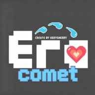

# uEmuera-Comet




Android 上运行 **Emuera / eramaker 脚本（era 系列游戏）** 的运行时，基于 Unity + IL2CPP。

本项目主要解决手机端的**图片/资源显示异常**（资源加载失败、图片变文本、启动即退出、被系统 OOM 杀掉），是 [xerysherry/uEmuera](https://github.com/xerysherry/uEmuera) **v0.2.9d** 的第三方修改版，引擎内核为 **Emuera 1824v15**，修复时对照 **Emuera 1824 + v24** 源码。

> ### ⚠️ 关于源码
> **0.1 版本的源码已丢失。** 原 Unity 工程已从磁盘删除，无 git、无备份，IL2CPP 产物无法反编译出方法体。
> **本仓库的 0.2 是重建版**：上游快照（2026-05-02）+ Trae 编辑器历史还原的 18 个文件（05-02 ~ 05-05）+ 1 个反推文件 `IDrawContext.cs`，再叠加 0.2 的修复。
> 还原过程、APK 逆向取证、永久丢失的部分见 [docs/源码恢复说明.md](docs/源码恢复说明.md)。
> 仓库旧提交保留为标签 **`v0.1-source`**，但它只是 2026-05-02 的底座（128 个 `.cs`，**不含** GXX 光栅化、WebP 解码等 Comet 改动）。

## 截图

| 开始界面 | 游戏运行 |
|---|---|
|  |  |

| 快捷按钮 | 指令输入 |
|---|---|
|  |  |

缩放控制


## 下载

**[uEmuera-Comet-0.2.apk](https://github.com/zxf212/uEmuera-Comet/releases/download/v0.2/uEmuera-Comet-0.2.apk)** · 全部版本见 [Releases](../../releases)

| 项 | 值 |
|---|---|
| 版本 | 0.2（versionCode 17） |
| 包名 | `com.uemuera.comet` |
| 体积 | 33.6 MB（0.1 为 66.3 MB 的 Development Build） |
| MD5 | `fefc29abdd8bf7421bc4c1c4ba587d63` |
| 构建 | IL2CPP，ARMv7 + ARM64，Release |
| 实测 | MuMu 12（Android 12，6 GB）+ Android 真机；eraTW 系两个发行包 |

## 0.2 做了什么

| # | 现象 | 根因 | 提交 |
|---|---|---|---|
| 1 | 资源 CSV 全失败，图片不显示 | 后台线程读 `Texture.width` 触发 Unity 主线程检查 | `47314f8` |
| 2 | 启动即退出（`ERHの読み込み中にエラー`） | Android 小写重扫导致 ERH 加载两次 → `#DIM` 重复 → Lv2 致命 | `f9e7a48` |
| 3 | 6 GB 设备被系统 OOM 杀掉 | 启动解码全部 2540 张图，纹理 + 缓存 ≈ 10.4 GB | `dc2bce1` |
| 4 | eraTW 类游戏满屏「解釈できない識別子」 | 读不到 `emuera.config` → 不搜子目录 → 脚本未加载 | `34a2b04` |
| 5 | 满屏 `警告Lv2:定義していないキャラクタ変数` | 角色文件为 `Chara0.csv`，严格 `CHARA*.CSV` 在大小写敏感 FS 命中 0 个 | `c71caf7` |
| 6 | GCREATE 画布不可用 / GSAVE 存空图 | 画布未置脏、像素缓冲未上传、未每帧刷新 | `cae93e5` `1986600` `452f8bc` |

完整证据（日志、内存数字、文件计数）见 [CHANGELOG.md](CHANGELOG.md) 与 [docs/验证记录.md](docs/验证记录.md)。

### 参考 Emuera 1824 + v24 的地方

| 位置 | v24 写法 | 本项目处理 |
|---|---|---|
| `HeaderFileLoader.cs` | 无 Android 小写重扫 | 删掉 5 处 `#if (UNITY_ANDROID \|\| UNITY_IOS)` 重扫 |
| `Config.getFiles()` | Windows 天然忽略大小写 | 单次枚举 + 忽略大小写匹配，语义等同 Windows/v24 |
| `GCREATE` | 创建即有效空图 | 创建即置脏，保证 `ApplyPixelBuffer` 执行 |
| `ConstImage` | 只持一份 `Bitmap` | 去掉常驻 `pixelCache`，按需构建 |
| `SearchSubdirectory` | 默认 `NO` | 默认 `NO`，仅配置缺失时兜底 `YES` |
| `GSAVE` | 先落像素缓冲再存 | 补 `ApplyPixelBuffer()` |

不复制 v24 的 GDI+ 实现（颜色矩阵、双三次插值仍缺）。

## 如何使用

1. era 脚本（`*.csv` / `*.ERB` / `*.ERH`）必须是 **UTF-8** 编码；
2. 首次启动允许「文件访问」权限；
3. 游戏文件夹放到 `storage/emulated/0/emuera/`（也支持 `/1/`、`/2/`）；
4. 若有 `emuera.config`，「サブディレクトリを検索する」建议为 `YES`；缺失时本版本自动开启。

## 构建

- Unity **2022.3.62f3c1**（含 Android Build Support / IL2CPP / NDK）、Android SDK、JDK 17
- **工程路径不能含非 ASCII 字符**，否则报 `Invalid project path ... non-ASCII characters`

```bash
Unity.exe -batchmode -quit -projectPath "<工程路径>" -buildTarget Android \
  -executeMethod CometBuild.BuildAndroid -logFile "<日志路径>"
```

产物 `<工程根目录>/Builds/uEmuera-Comet-0.1.apk`；日志出现 `[CometBuild] 结果=Succeeded` 即成功。
编辑器内构建：`File → Build Settings → Android → Build`。

## 已知问题

| 项 | 状态 |
|---|---|
| 颜色矩阵 `cm`、双三次插值 | 未实现（**0.1 也没有**，Comet 分支历史欠账） |
| `UnityDrawContext` | 已实现 `IDrawContext` 但无调用方，死代码 |
| 首次绘制延迟 | 按需解码，首次显示某图几十毫秒 |
| 长时游玩稳定性 | 未压测（纹理 60/120/300 秒无引用回收） |
| 游戏兼容性 | 仅 2 个发行包回归 |
| App 内改配置 | 继承上游，不支持 |

## 目录

```
Assets/Editor/CometBuild.cs            命令行构建入口（0.2 新增）
Assets/Scripts/SpriteManager.cs        纹理：按需解码、像素缓存、回收
Assets/Scripts/uEmuera/ImageHeader.cs  图片头解析（0.2 新增）
Assets/Scripts/Emuera/Config/Config.cs 文件枚举（忽略大小写匹配）
docs/源码恢复说明.md                     重建过程与存疑点
docs/验证记录.md                         实测数据与未验证项
CHANGELOG.md
```

## 许可与声明

- 基于 **xerysherry/uEmuera v0.2.9d**（**Apache-2.0**）修改，上游为 emuera1824v15。作者：**xerysherry**；Emuera 解释器作者：**MinorShift** 等。
- **允许商用。** Apache-2.0 与 Emuera 原版许可（`Assets/StreamingAssets/license@emuera`）均明确允许将本软件用于任何目的，**包括商业应用**。
- 但须遵守 Emuera 原版许可的三项条件：① 不得虚示来源、不得声称原创；② 修改过源码必须明示；③ 不得删除或改动许可声明。本版本按此三项执行。
- 本修改与原作者无关，使用本版本导致的任何问题由使用者自行承担。
- 若权利人认为本版本不妥，请提 Issue，我会立即处理。
